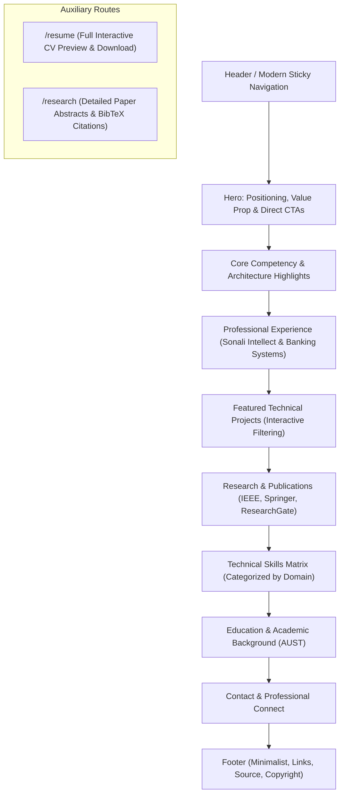
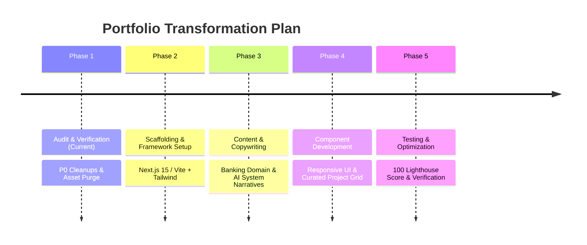

# Comprehensive Portfolio Audit & Modernization Blueprint

**Project:** Mostafiz Fahim Portfolio  
**Repository:** `https://github.com/MostafizFahim/my-portfolio`  
**Current Directory:** `E:\My_portfolio`  
**Auditor Roles:** Senior Frontend Engineer, UI/UX Designer, Technical Architect, Technical Career Branding Consultant  
**Date:** March 2026 / Local Audit  
**Document Status:** Complete Audit Report (Pre-Implementation)

---

## 1. Executive Summary

This audit evaluates the personal portfolio website of **Mostafizur Rahman Fahim**. The website currently represents an early-stage portfolio built upon a widely recognized open-source template (the *Soumyajit4419* React portfolio). While the project contains valuable evidence of real technical capability—including enterprise banking engineering, deployed full-stack systems, and published peer-reviewed research—the existing presentation significantly undervalues Fahim's professional credentials.

### Key Audit Findings:
1. **Template Baggage & Branding Identity:** The codebase still contains residual assets and conventions from the original template author (including the template creator's resume PDF in `src/Assets/`, generic cartoon vector illustrations, and unreferenced project images). The aesthetic relies on an outdated 2020-era purple-glow, starry canvas particle aesthetic that signals "student template" rather than "enterprise software engineer / AI specialist."
2. **Critical Content Misalignment:** Fahim is a practicing Software Engineer at **Sonali Intellect Limited** working on enterprise banking systems (Java, Spring Boot, Spring MVC, legacy banking platforms, JMS, JBoss) and advancing into **AI Engineering, RAG architectures, and Backend Systems**. However, the website's SEO metadata brands him as a *"Java Developer Intern,"* his real-world job experience is buried inside an auxiliary `/more-info` page behind an obscure navbar button, and toy 1st-year university coursework (such as a 2D C game and basic PHP homework) shares equal billing with enterprise banking microservices and IEEE research publications.
3. **Severe Technical Debt:** The project runs on **React 17.0.2** and **Create React App (`react-scripts 5.0.0`)**, both of which are officially deprecated. An `npm audit` reveals **97 known vulnerabilities** (including 10 critical and 46 high). Architectural flaws include active memory leaks in the navigation bar (`scroll` listeners added directly in render cycles), an artificial 1200ms preloader delaying every visit, and two unorganized CSS stylesheets exceeding 1,800 lines with pervasive `!important` declarations.
4. **Asset & Performance Bloat:** The repository contains over **13 MB of uncompressed PNG images** (with single screenshots exceeding 3.3 MB), uncompressed logos, and external dependencies on un-cached third-party GitHub statistics widgets that frequently fail or throttle.

**Verdict:** The portfolio requires an architectural, design, and content modernization. It should be transitioned from a fragmented, template-based student site into an authoritative, high-performance portfolio tailored for Senior/Mid Software Engineer, Backend Engineer, and AI Engineer positioning.

---

## 2. Existing Technology Stack

| Layer | Current Technology | Version | Status & Technical Assessment |
| :--- | :--- | :--- | :--- |
| **Core Framework** | React | `^17.0.2` | Deprecated. React 19 is active; React 18 introduced concurrent rendering and `createRoot`. |
| **DOM Renderer** | React DOM | `^17.0.2` | Uses legacy `ReactDOM.render` API in `index.js`. |
| **Build Tooling** | Create React App (`react-scripts`) | `5.0.0` | Deprecated by React team. Slow Webpack 5 builds; unmaintained. |
| **Routing** | React Router DOM | `^6.2.2` | Functional, but basic client-side routing lacks SSR/SSG metadata support. |
| **UI Components** | React-Bootstrap | `^2.2.1` | Heavy abstraction layer over Bootstrap. |
| **CSS Framework** | Bootstrap | `^5.1.3` | Outdated Bootstrap version; largely overridden by custom `!important` CSS. |
| **Iconography** | React Icons | `^4.12.0` | Massive icon suite importing large bundles without strict tree-shaking. |
| **Canvas / FX** | react-tsparticles | `^1.42.2` | Legacy v1 branch using deprecated `params` API. Consumes high CPU/GPU on mobile. |
| **3D / Motion** | react-parallax-tilt | `^1.7.42` | Functional, but adds unnecessary DOM manipulation and layout recalculations. |
| **Typography FX** | typewriter-effect | `^2.18.2` | Generic typewriter animation; clutters hero scanability. |
| **PDF Handling** | react-pdf | `^5.7.1` | Relies on CDN script injection for `pdf.worker.min.js`; renders only page 1. |
| **PDF Generation** | @react-pdf/renderer | `^2.2.0` | **Dead dependency.** Installed in `package.json` but never imported or used. |
| **HTTP Client** | axios | `^0.26.1` | **Dead dependency.** Installed in `package.json` but never imported or used. |
| **GitHub Stats** | react-github-calendar | `^3.2.2` | Outdated version. |

---

## 3. Repository Architecture & Code Quality Audit

### 3.1 Folder Structure Analysis

```
E:\My_portfolio
├── .gitignore                      # Standard CRA gitignore
├── package.json                    # Outdated dependencies, unused packages
├── package-lock.json               # 1,335 resolved packages (97 vulnerabilities)
├── README.md                       # Blank file (2 bytes)
├── Images/                         # Root directory containing unreferenced screenshots (readme-img.png, etc.)
├── public/
│   ├── favicon.png                 # Generic purple favicon
│   ├── index.html                  # Duplicate meta tags, outdated "Intern" description, broken image URLs
│   ├── manifest.json               # Minimal CRA manifest
│   ├── Mostafiz_Fahim_CV.pdf       # 163 KB CV file
│   └── robots.txt                  # Allow-all robots file
└── src/
    ├── App.js                      # Main router with artificial setTimeout loader
    ├── App.css                     # 1,088 lines of legacy boilerplate mixed with custom styles
    ├── style.css                   # 743 lines of global styles with ubiquitous !important overrides
    ├── index.js                    # Uses deprecated ReactDOM.render
    ├── index.css                   # Small reset file
    ├── reportWebVitals.js          # Default CRA web vitals script
    ├── setupTests.js / App.test.js # Default tests (not updated for custom components)
    ├── Assets/                     # 17 images totaling >13 MB; contains template author's PDF resume!
    └── components/
        ├── Footer.js               # Footer with personal social links
        ├── Navbar.js               # Navbar with scroll listener leak and full-page refresh brand bug
        ├── Particle.js             # 160-particle continuous canvas loop
        ├── Pre.js                  # Preloader div container
        ├── ScrollToTop.js          # Window scroll reset on route change
        ├── Home/                   # Home.js, Home2.js, Type.js
        ├── About/                  # About.js, AboutCard.js, Techstack.js, Toolstack.js, BlockChain.js, Github.js
        ├── Projects/               # Projects.js, ProjectCards.js
        ├── Publications/           # Publications.js
        ├── MoreInfo/               # MoreInfo.js (Houses actual job experience & education)
        └── Resume/                 # ResumeNew.js (react-pdf embed)
```

### 3.2 Specific Architectural & Code Flaws

1. **Window Scroll Event Listener Leak (`src/components/Navbar.js`):**
   ```javascript
   // In Navbar.js line 30:
   window.addEventListener("scroll", scrollHandler);
   ```
   This listener is attached directly in the body of the `NavBar` component rather than inside a `useEffect` hook. Every time the component re-renders (such as state changes on toggle or route switches), a new event listener is registered to the window object without cleanup, creating an escalating memory leak.

2. **Full Page Refresh on Brand Logo Click (`src/components/Navbar.js`):**
   ```jsx
   <Navbar.Brand href="/" className="d-flex">
   ```
   The brand logo uses a raw HTML `href="/"` rather than React Router's `<Link to="/">` or `as={Link}`. Clicking the brand icon causes a hard browser reload, dumping React state and triggering the artificial preloader.

3. **Artificial Render Delay (`src/App.js`):**
   ```javascript
   useEffect(() => {
     const timer = setTimeout(() => {
       upadateLoad(false);
     }, 1200);
     return () => clearTimeout(timer);
   }, []);
   ```
   The application intentionally forces a full-screen loading spinner for 1.2 seconds on every initial load. In modern web development, artificial loaders destroy First Contentful Paint (FCP) and Largest Contentful Paint (LCP) Core Web Vitals.

4. **Template Residuals in Assets:**
   - `src/Assets/Soumyajit_Behera-BIT_MESRA.pdf` is still present in the repository.
   - Multiple unused images from the original template remain committed: `chatify.png`, `codeEditor.png`, `emotion.png`, `leaf.png`, `suicide.png`, and `blog.png`.
   - `logo1.png` (1.43 MB) and `logo2.png` (1.40 MB) are enormous uncompressed PNG files used for a tiny 50px navbar logo.

5. **Monolithic, Unmaintainable CSS (`App.css` & `style.css`):**
   - Two separate files totaling over 1,830 lines.
   - Pervasive use of `!important` to fight Bootstrap defaults.
   - Hardcoded hex and rgba color values repeated across dozens of rules instead of a centralized CSS design token or Tailwind configuration.

---

## 4. Existing Website UI/UX Audit (Section by Section)

### 4.1 Landing Page / Hero Section (`/`)
* **What currently exists:**
  - A dark cosmic background with animated star particles.
  - Eyebrow text: *"Software Engineer | Full-Stack Developer | Java & Spring Boot"*.
  - Heading: *"Hi There! I'M Mostafiz Fahim"*.
  - A summary paragraph summarizing banking, full-stack, and AI exploration.
  - A `Typewriter` cycling through 6 phrases.
  - A generic flat-vector SVG illustration of a person at a laptop (`home-main.svg`).
  - Below the fold (`Home2.js`): "LET ME INTRODUCE MYSELF", avatar illustration with tilt effect, paragraph text, and social icons.
* **What works well:** The copy in the summary paragraph is descriptive and mentions enterprise banking and AI.
* **What looks outdated:**
  - The generic vector illustrations (`home-main.svg` and `avatar.svg`) are hallmark template assets that diminish uniqueness and engineering authenticity.
  - The animated typewriter creates visual instability and forces visitors to wait to see your capabilities.
  - Starry background particles feel like a hobbyist portfolio rather than an enterprise engineer's portfolio.
* **Recommendations:**
  - Replace the cartoon illustration with an engineering-focused visual: an interactive system architecture diagram, terminal preview, or a clean professional photograph.
  - Replace the typewriter with a definitive, crisp value proposition.
  - Present immediate call-to-actions (CTAs): *"View Enterprise Systems"*, *"Explore AI & Research"*, *"Download CV"*.

### 4.2 About Me Section (`/about`)
* **What currently exists:**
  - "Know Who I AM" card with a brief bio, list of personal hobbies, and a quote.
  - A laptop graphic (`about.png`).
  - A massive grid of 28 tech icons (`Techstack.js`).
  - A grid of 19 development tool icons (`Toolstack.js`) with custom hover tooltips.
  - A dedicated "Blockchain & Web3 Technologies" sub-section (`BlockChain.js`) with 5 icons.
  - A GitHub activity section with `react-github-calendar` and 3 dynamic external image cards.
* **What works well:** The GitHub calendar and clear articulation of CSE degree at AUST.
* **What looks outdated & needs fixing:**
  - Flat icon soup: Techstack displays 28 unranked icons (C, C++, PHP, HTML, CSS, Solidity, Next.js, Angular, Spring Boot, etc.) without proficiency levels, architectural context, or domain categorization.
  - Third-party GitHub streak/stats images rely on un-cached Heroku/Vercel services (`github-readme-streak-stats.herokuapp.com`). When these services experience downtime or rate-limiting, they render broken image icons.
  - The laptop graphic is generic clipart.
* **Recommendations:**
  - Structure technical competencies into logical architectural domains:
    - *Enterprise Backend & Architecture* (Java 17/21, Spring Boot, Spring MVC, JMS, JBoss, .NET Core, Microservices, REST APIs).
    - *AI, Machine Learning & RAG* (Python, Gemini API, RAG, LangChain, PyTorch, TensorFlow, Vector DBs, Prompt Engineering).
    - *Databases & Messaging* (PostgreSQL, MS SQL Server, MySQL, SQLite, JMS, Redis).
    - *Frontend & Full Stack* (TypeScript, Angular, React, Next.js, Tailwind CSS).
  - Eliminate broken third-party external stat images; retain a clean, reliable GitHub calendar.

### 4.3 Work Experience (`/more-info`)
* **What currently exists:**
  - Buried under `/more-info`.
  - Listed card: *"Software Engineer at Sonali Intellect Limited (Feb 2026 - Present)"* detailing Java 17, Spring Boot, Angular, enterprise banking systems, and relational databases.
  - **Severe Confusion:** Two personal side projects (*"AI Knowledge Base Assistant"* and *"Banking Microservices Application"*) are placed directly inside the Experience column alongside actual employment.
* **What works well:** The bullet points for the Sonali Intellect role accurately describe enterprise backend engineering.
* **What looks outdated & needs fixing:**
  - Having work experience hidden under a vague "More Info" navbar tab is fatal for recruiter conversion. Recruiters evaluate experience within the first 10 seconds.
  - Mixing personal projects into the formal employment timeline confuses the viewer regarding what was professional production work versus personal portfolio exploration.
* **Recommendations:**
  - Promote **Work Experience** to the main navigation and a primary section on the homepage or dedicated `/experience` page.
  - Separate commercial employment at Sonali Intellect from personal/open-source projects.
  - Expand banking domain achievements: highlight legacy system integration (JMS, JBoss), transaction safety, secure financial workflows, and enterprise compliance.

### 4.4 Projects Section (`/project`)
* **What currently exists:**
  - 11 project cards in a 3-column Bootstrap grid.
  - Includes:
    1. AI Knowledge Base Assistant (ASP.NET Core, React, Gemini API, RAG)
    2. Banking Microservices Application (Java 21, Spring Boot, Angular, PostgreSQL)
    3. NexTrip Hybrid Blockchain Ride-Sharing (Thesis project)
    4. Cloud Restaurant Management (ASP.NET Core, MS SQL)
    5. Keystone Education Consultancy (Next.js, Tailwind)
    6. Shopping App - Kotlin & Firebase (Android)
    7. Hospital Management Systems (Java Desktop & PHP)
    8. IoT & Embedded Systems (Arduino, ESP32, Raspberry Pi)
    9. Exam Enrollment System (Android Java)
    10. 3D Building & Playground (Three.js)
    11. Zombie Attack 2D Game (C, igraphics)
* **What works well:** The top 2 projects (AI Knowledge Base and Banking Microservices) feature live production demo links, backend health endpoints, and rich technology badge tags.
* **What looks outdated & needs fixing:**
  - Dilution of technical stature: Listing 1st-year academic exercises (Zombie Attack in C, Three.js playground, basic PHP hospital system) right alongside enterprise banking microservices and RAG architectures damages professional credibility.
  - Screenshot sizes are massive: `zombie.png` is 3.36 MB, `hospital.png` is 2.03 MB, `cloud-restaurant.png` is 1.23 MB.
  - Lack of filtering or categorization: Visitors cannot filter between AI/ML, Backend, Full Stack, or Mobile.
* **Missing Projects (from Profile Guidelines):**
  - **Human-Virus Protein-Protein Interaction (PPI) Prediction Research:** Completely absent from the project cards.
  - **AgroNet Deep Learning Disease Detection:** Mentioned in one sentence in `Home2.js` as having 94.12% accuracy, but has no project card or GitHub repository showcase.
  - **Medical AI / Monkeypox prediction:** Only listed in Publications; no dedicated interactive project card.
* **Recommendations:**
  - Curate and filter projects into clear tiers:
    - **Featured Tier (Enterprise & AI Systems):** AI Knowledge Base Assistant (RAG), Banking Microservices Application, AgroNet Deep Learning, Human-Virus PPI Prediction System, NexTrip Decentralized Architecture.
    - **Engineering & Full-Stack Tier:** Cloud Restaurant Management, Keystone Education Consultancy, IoT Healthcare Monitor.
    - **Archive / Academic Tier:** Demote or remove 2D C games and beginner desktop apps from primary view.

### 4.5 Research Publications (`/publications`)
* **What currently exists:**
  - 4 published papers:
    1. *Predicting Agricultural Land Suitability and Soil Quality: A Deep Learning Approach for Precision Agriculture* (Springer Conference)
    2. *NexTrip: A Semi-Public Blockchain Architecture for Privacy-Preserving Ride-Sharing with RAFT Consensus and IPFS-Enabled Data Storage* (IEEE ICCIT 2025)
    3. *Machine Learning for Monkeypox Prediction* (IEEE QPAIN 2025)
    4. *Design of Blockchain Ride-Sharing with IPFS* (IJAIT Journal)
  - Links to Springer, IEEE Xplore, ResearchGate, and Google Drive certificates.
* **What works well:** This is one of the strongest sections on the site. Genuine IEEE and Springer publications establish immediate technical authority.
* **What looks outdated & needs fixing:**
  - Cards use basic Bootstrap styles with purple badges.
  - Does not showcase publication metrics, citation counts, DOI badges, or downloadable preprints.
* **Recommendations:**
  - Give this section high prominence. For AI/Backend roles, peer-reviewed research in applied deep learning and distributed systems is a massive differentiator.
  - Add DOI links, BibTeX citation copy buttons, and clear badges indicating indexed status (IEEE / Springer / Scopus).

### 4.6 Education, Certifications & Additional Info (`/more-info`)
* **What currently exists:**
  - AUST B.Sc. in CSE (Dec 2021 - Dec 2025, CGPA 3.105/4.00).
  - Certifications: Web Development Bootcamp (2025), Advanced Graphics Design (2016), Office Productivity Suite (2014).
  - Beyond Code: Football, AUST Computer Club, Tech events.
* **What looks outdated & needs fixing:**
  - Displaying 10-to-12-year-old certifications ("Office Productivity Suite 2014" and "Graphics Design 2016") on a 2026 Software Engineer portfolio looks amateurish.
  - Education is hidden inside `/more-info`.
* **Recommendations:**
  - Remove pre-university 2014/2016 certificates immediately.
  - Feature AUST B.Sc. degree cleanly in an Education & Academic Background section.
  - Highlight relevant upper-level coursework: Distributed Systems, Artificial Intelligence, Database Systems, Computer Networks, Machine Learning.

### 4.7 Resume / CV Section (`/resume`)
* **What currently exists:**
  - Download buttons for `Mostafiz_Fahim_CV.pdf`.
  - In-browser preview using `react-pdf` with a worker fetched from an un-versioned public CDN.
* **What works well:** One-click download button.
* **What looks outdated & needs fixing:**
  - The in-browser viewer only renders `pageNumber = 1`. If the CV has 2 or more pages, subsequent pages are completely cut off and inaccessible in the viewer!
  - Relying on CDN injection for PDF.js workers frequently breaks behind corporate proxies, ad-blockers, or slow mobile connections.
* **Recommendations:**
  - Support multi-page rendering or replace the heavy canvas PDF viewer with a clean, responsive HTML-rendered resume preview accompanied by a high-visibility PDF download button.

### 4.8 Navigation & Footer
* **Navbar:**
  - Links: Home, About, Projects, Resume, Publications, and a pill button for "More Info".
  - Issues: Brand logo triggers full page reload; scroll listener leaks memory; "More Info" button creates bad information architecture.
* **Footer:**
  - Copyright notices and 3 icons: GitHub, LinkedIn, Instagram.
  - Issues: Links to personal Instagram account; missing contact email, ResearchGate, or technical platforms.

---

## 5. Content and Professional Profile Audit

### 5.1 Alignment Against Current Professional Direction

| Target Career Pillar | Current Website Status | Required Realignment |
| :--- | :--- | :--- |
| **Banking Software Engineer** | Mentioned briefly in `Home2.js` and hidden under `/more-info`. | Promote to hero headline. Detail enterprise reliability, banking microservices, Java 17/21, Spring Boot, Spring MVC, transaction management, and legacy systems (JMS, JBoss). |
| **Backend Engineer** | Distributed across multiple generic lists. | Emphasize system design, scalable REST APIs, relational database optimization (PostgreSQL, MS SQL Server), JWT authentication, role-based access control, and architectural patterns. |
| **AI Engineer / Full Stack AI** | Represented primarily by a single ASP.NET Core + Gemini API project. | Showcase expertise in RAG pipelines, vector embeddings, LLM orchestration, prompt engineering, FastAPI integration, and AI agent concepts. |
| **AI & Deep Learning Researcher** | Publications are present, but research projects (Human-Virus PPI, AgroNet, Medical AI) are fragmented or omitted from project cards. | Create dedicated case studies for Human-Virus Protein-Protein Interaction prediction, AgroNet disease classification (94.12% accuracy), and Medical AI. |
| **Enterprise Java & Legacy Stack** | Buried in `/more-info` bullet points. | Explicitly highlight practical comfort with enterprise reality: legacy Java banking codebases, JMS message brokers, JBoss application servers, and modern Spring Boot modernization. |

### 5.2 Outdated & Conflicting Information to Correct
1. **Remove "Java Developer Intern" Everywhere:** Public metadata (`public/index.html`) still describes Fahim as an "Intern." Replace with **"Software Engineer | Backend & AI Systems"**.
2. **Purge Irrelevant Credentials:** Delete the 2014 Office Productivity and 2016 Graphics Design certificate entries.
3. **Correct Social Media Links:** Remove personal Instagram and Facebook links from professional headers/footers. Add direct Email (`mailto:`), ResearchGate, and optionally LeetCode/X.

---

## 6. Technical Quality & Performance Audit

### 6.1 Performance Bottlenecks & Core Web Vitals
* **Largest Contentful Paint (LCP):**
  - Severely damaged by the 1,200ms hardcoded setTimeout in `App.js`.
  - Aggravated by multi-megabyte uncompressed images (`logo2.png` at 1.4 MB, `zombie.png` at 3.36 MB, `hospital.png` at 2.03 MB).
* **Cumulative Layout Shift (CLS):**
  - Image elements lack explicit `width` and `height` aspect ratio containers, causing large content reflows upon image load.
  - External GitHub widgets iframe/image elements pop into the layout asynchronously without reserved space.
* **Total Blocking Time (TBT) & INP:**
  - `react-tsparticles` continuously executes canvas animation calculations on the main JavaScript thread, degrading scrolling smoothness on lower-end devices and laptops running on battery saver.

### 6.2 Asset Size Breakdown (The 13 MB Audit)

| Asset File | Path | Size | Usage Status | Recommended Fix |
| :--- | :--- | :--- | :--- | :--- |
| `zombie.png` | `src/Assets/Projects/` | **3,366 KB** | Displayed in Projects | Convert to WebP (<80 KB) or archive project |
| `hospital.png` | `src/Assets/Projects/` | **2,035 KB** | Displayed in Projects | Compress to WebP (<75 KB) |
| `logo1.png` | `src/Assets/` | **1,436 KB** | **Unused template file** | Delete |
| `logo2.png` | `src/Assets/` | **1,409 KB** | Used as 50px navbar logo | Convert to clean SVG (<5 KB) |
| `building-playground.png` | `src/Assets/Projects/` | **1,236 KB** | Displayed in Projects | Compress to WebP (<90 KB) |
| `cloud-restaurant.png` | `src/Assets/Projects/` | **1,231 KB** | Displayed in Projects | Compress to WebP (<85 KB) |
| `nextrip.png` | `src/Assets/Projects/` | **765 KB** | Displayed in Projects | Compress to WebP (<60 KB) |
| `keystone.png` | `src/Assets/Projects/` | **643 KB** | Displayed in Projects | Compress to WebP (<60 KB) |
| `leaf.png` | `src/Assets/Projects/` | **578 KB** | **Unused template file** | Delete |
| `exam.png` | `src/Assets/Projects/` | **486 KB** | Displayed in Projects | Compress to WebP (<50 KB) |
| `emotion.png` | `src/Assets/Projects/` | **402 KB** | **Unused template file** | Delete |
| `suicide.png` | `src/Assets/Projects/` | **399 KB** | **Unused template file** | Delete |
| `codeEditor.png` | `src/Assets/Projects/` | **174 KB** | **Unused template file** | Delete |
| `blog.png` | `src/Assets/Projects/` | **131 KB** | **Unused template file** | Delete |
| `chatify.png` | `src/Assets/Projects/` | **57 KB** | **Unused template file** | Delete |
| `Soumyajit_Behera-BIT_MESRA.pdf` | `src/Assets/` | **50 KB** | **Unused foreign resume**| Delete |

*Total wasted dead weight in assets alone: **~12.8 MB**.* With modern compression and WebP formatting, the entire portfolio's image payload can be reduced to under **600 KB total**.

### 6.3 Security & Vulnerability Analysis
Running `npm audit` on the existing repository yields:
- **97 vulnerabilities:** 10 Critical, 46 High, 21 Moderate, 20 Low.
- Root causes: Deprecated Create React App dependencies (`webpack-dev-server`, `browserslist`, `trim`, `nth-check`, `loader-utils`, `immer`).
- CRA is officially unmaintained; these security warnings cannot be cleanly resolved within the CRA ecosystem without ejecting or migrating.

### 6.4 Accessibility (a11y) & SEO Issues
- **Focus Rings Suppressed:** `style.css` explicitly disables keyboard focus rings: `button:focus { box-shadow: none !important; }`, preventing keyboard navigation for accessibility.
- **Low Contrast Ratios:** Light purple `#c770f0` on dark violet/black backgrounds fails WCAG AA standards for small text.
- **Missing Landmark Roles & Headings:** Multiple `<h1>` tags on single pages; non-semantic `div` and `span` containers used instead of semantic `<main>`, `<article>`, and `<header>` tags.
- **Broken SEO Assets:** OpenGraph and Twitter card image tags point to a hardcoded URL on GitHub that 404s.

---

## 7. Recommended Modern Design Direction

### 7.1 Aesthetic Concept: *Engineering Precision & Clean Architectural Dark Mode*
Move away from the 2020 cyberpunk/purple template look toward an aesthetic inspired by top engineering brands like **Vercel, Linear, Stripe, and GitHub Next**:
- **Palette:**
  - Backgrounds: Deep rich slate/zinc (`#09090b`, `#121215`, `#18181b`).
  - Borders: Subtle neutral dividers (`rgba(255, 255, 255, 0.08)`).
  - Text: High-contrast crisp white (`#f4f4f5`) for headings, muted zinc (`#a1a1aa`) for readable body copy.
  - Accent Color: A refined, singular brand accent—such as **Electric Cyan (`#06b6d4`)** or **Precision Indigo (`#6366f1`)**—used purposefully for key highlights and interactive states, rather than overwhelming purple neon.
- **Typography:**
  - Primary Sans: `Inter` or `Geist Sans` for clean, modern legibility.
  - Monospace Accent: `JetBrains Mono` or `Geist Mono` for technical tags, metrics, commit links, and code snippets.
- **Visuals & Motion:**
  - Replace canvas particles with clean, subtle CSS grid backgrounds or smooth radial glows.
  - Restrained transitions (micro-interactions on card hover, smooth section transitions via `framer-motion`).
  - Clean architecture diagrams or UI mockups instead of cartoon vectors.

---

## 8. Recommended Modern Technology Stack

To ensure longevity, 100/100 Lighthouse scores, and effortless maintainability, we recommend:

### Modern Architecture Option A: Next.js 15 (App Router) + Tailwind CSS (Recommended)
* **Framework:** Next.js 15 (React 19, App Router)
* **Styling:** Tailwind CSS v4 + `shadcn/ui` components
* **Icons:** `lucide-react` (featherlight, tree-shakeable)
* **Animations:** `framer-motion`
* **Why this is the superior choice:**
  - **Static Site Generation (SSG):** Pre-renders every page at build time for instant page loads (TTFB < 50ms) and perfect SEO crawlability.
  - **Native Image Optimization:** `next/image` automatically converts all project screenshots to AVIF/WebP, generates responsive srcsets, and prevents CLS.
  - **Dynamic Metadata & OpenGraph:** Clean metadata generation for LinkedIn/Twitter previews without hardcoded URLs.
  - **Zero Security Warnings:** Eliminates CRA and all 97 dependency vulnerabilities.

### Alternative Option B: Vite + React 19 + Tailwind CSS (Lightweight SPA Alternative)
* **Framework:** React 19 + Vite 6
* **Styling:** Tailwind CSS + Radix UI primitives
* **Why consider this:** If hosting exclusively as a static bundle on standard static web servers without any Node runtime, Vite provides instantaneous local HMR and sub-second builds while removing all legacy CRA bloat.

---

## 9. Proposed New Website Structure & Information Architecture

We propose replacing the disjointed multi-page structure with a unified, high-converting **Single-Page Architecture with Dedicated Route Support**:



### Detailed Section Breakdown:

1. **Header / Navigation:**
   - Monogram logo / clean brand typography.
   - Smooth navigation links: *About*, *Experience*, *Projects*, *Research*, *Skills*, *Contact*.
   - Direct CTA: *Resume (PDF)* and *GitHub/LinkedIn* quick links.

2. **Hero Section:**
   - **Headline:** *"Mostafiz Fahim — Software Engineer"*
   - **Subheading:** *"Building Enterprise Banking Systems & Engineering AI/RAG Applications"*
   - **Core Summary:** *"Software Engineer at Sonali Intellect Limited specializing in enterprise Java, Spring Boot, banking backends, and full-stack systems. Actively developing LLM-powered applications, RAG pipelines, and applied deep learning systems."*
   - **Primary Action Buttons:** `[View Featured Projects]`, `[Read Publications]`, `[Get in Touch]`.

3. **Professional Work Experience (Promoted to Top Level):**
   - **Sonali Intellect Limited — Software Engineer (Feb 2026 – Present)**
   - Highlight banking software domain expertise:
     - Enterprise backend architecture with Java 17/21, Spring Boot, and Spring MVC.
     - Hands-on exposure to legacy banking infrastructure, enterprise messaging with JMS, and JBoss application server environments.
     - Role-based security, financial transaction workflows, and database integrity (PostgreSQL, MS SQL Server).
     - Full-stack features with Angular, TypeScript, and secure RESTful services.

4. **Curated & Filterable Projects:**
   - Filter Tabs: `[All]`, `[AI & RAG]`, `[Enterprise Backend]`, `[Research & ML]`, `[Full Stack]`.
   - **Featured Projects:**
     - **AI Knowledge Base Assistant:** ASP.NET Core, React, TypeScript, Gemini API, RAG document chunking, SQLite, JWT.
     - **Banking Microservices Application:** Java 21, Spring Boot, Spring Security, Angular, PostgreSQL, JWT, Chart.js.
     - **AgroNet Deep Learning Model:** Cucumber leaf disease classification with 94.12% accuracy.
     - **Human-Virus Protein-Protein Interaction (PPI) Prediction:** Machine learning architecture for viral interaction forecasting.
     - **NexTrip Decentralized Ride-Sharing:** Semi-public blockchain with Ethereum smart contracts, Hyperledger Fabric, IPFS, and RAFT consensus.
     - **Keystone Education Consultancy:** Production Next.js & Tailwind marketing web application.

5. **Peer-Reviewed Research Publications:**
   - Elevated with journal/conference logos, publication dates, and indexed badges (IEEE Xplore, Springer):
     - *Predicting Agricultural Land Suitability and Soil Quality* (Springer)
     - *NexTrip: Semi-Public Blockchain Architecture for Ride-Sharing* (IEEE ICCIT 2025)
     - *Machine Learning for Monkeypox Prediction* (IEEE QPAIN 2025)
     - *Design of Blockchain Ride-Sharing with IPFS* (IJAIT Journal)
   - ResearchGate profile button and direct DOI/Paper links.

6. **Structured Technical Skills Matrix:**
   - *Enterprise Backend:* Java (17/21), Spring Boot, Spring MVC, C# / ASP.NET Core, REST APIs, JMS, JBoss, Microservices.
   - *AI & Machine Learning:* Python, RAG Architectures, Gemini API, PyTorch, TensorFlow, LangChain, Vector Databases, Prompt Engineering.
   - *Databases & Persistence:* PostgreSQL, MS SQL Server, MySQL, SQLite, JPA / Hibernate.
   - *Frontend & UI:* TypeScript, Angular, React, Next.js, Tailwind CSS, HTML5/CSS3.
   - *DevOps & Tools:* Docker, Git, Linux, Postman, Swagger, Vercel, Railway, Render.

7. **Education & Academics:**
   - **Ahsanullah University of Science and Technology (AUST)**
   - B.Sc. in Computer Science and Engineering (Dec 2021 – Dec 2025)
   - Core Areas: Distributed Systems, Artificial Intelligence, Database Management, Software Engineering, Algorithms.

8. **Contact Section:**
   - Quick copy-to-clipboard for email address.
   - Direct message inquiry form.
   - Verified professional links: LinkedIn, GitHub, ResearchGate, LeetCode.

---

## 10. Prioritized Improvement Roadmap

### P0: Critical (Immediate Architectural & Identity Corrections)
* **P0.1: Eliminate Template Residue:** Delete `Soumyajit_Behera-BIT_MESRA.pdf`, unreferenced template PNGs (`chatify.png`, `suicide.png`, etc.), and cartoon vectors.
  - *Why:* Residual files from another engineer look careless and damage credibility.
* **P0.2: Fix Navbar Event Listener Leak & Reload Bug:** Wrap window scroll listeners in React hooks with clean teardown; replace `href="/"` brand reload with client router link.
  - *Why:* Prevents browser memory leaks and unwanted full-page reloads.
* **P0.3: Remove Artificial Preloader:** Delete the 1200ms `setTimeout` in `App.js`.
  - *Why:* Immediately saves 1.2 seconds of initial waiting time, radically improving Core Web Vitals.
* **P0.4: Promote Work Experience:** Relocate Sonali Intellect banking engineering experience from `/more-info` to the front-and-center homepage navigation.
  - *Why:* Real-world commercial engineering experience is the #1 item technical recruiters and hiring managers look for.
* **P0.5: Correct Public Metadata:** Update `public/index.html` to eliminate "Intern" references and replace broken OpenGraph image links.
  - *Why:* Link previews on LinkedIn, Twitter, and Slack currently show broken or misleading previews.

### P1: High Priority (Content Alignment & Professional Branding)
* **P1.1: Curate Project Portfolio:** Demote/remove 1st-year toy assignments (Zombie Attack in C, Three.js basic playground, basic PHP desktop scripts). Feature AI Knowledge Base, Banking Microservices, AgroNet, and NexTrip.
  - *Why:* Elevates perception from student coder to production engineer.
* **P1.2: Add Missing AI & Research Projects:** Build rich project cards for Human-Virus PPI Prediction and AgroNet (94.12% accuracy).
  - *Why:* Backs up your AI Engineer / ML claims with concrete technical artifacts.
* **P1.3: Clean Up Certifications & Social Links:** Remove 2014 MS Office and 2016 graphics certificates; replace personal Instagram with ResearchGate and direct Email.
  - *Why:* Ensures 100% of portfolio real estate reinforces high-value engineering skills.
* **P1.4: Multi-Page Resume Viewer:** Fix `ResumeNew.js` to render all pages of the CV or provide a clean responsive HTML summary with direct PDF download.
  - *Why:* Currently, any resume beyond page 1 is invisible in the site's viewer.

### P2: Medium Priority (Modernization & UI/UX Polish)
* **P2.1: Migrate Build Stack (Next.js 15 or Vite 6):** Retire Create React App and React 17; transition to Next.js or Vite with React 19.
  - *Why:* Eliminates 97 vulnerabilities, speeds up build times from 30s to <1s, and enables native image optimization.
* **P2.2: Replace CSS Monoliths with Tailwind CSS:** Deprecate `App.css` and `style.css` (1,800+ lines); implement consistent design tokens via Tailwind.
  - *Why:* Eliminates hundreds of `!important` hacks, enforces consistent typography/spacing, and slashes CSS bundle size to <10 KB.
* **P2.3: Asset Optimization & WebP Conversion:** Compress and convert all retained PNG screenshots (currently 13 MB) into responsive WebP images (<600 KB total).
  - *Why:* Slashes data transfer by >95%, ensuring fast mobile loading on any cellular connection.
* **P2.4: Replace Canvas Particles with Clean Minimal Background:** Replace `react-tsparticles` with a performant CSS grid/glow.
  - *Why:* Reduces CPU/GPU drain, preserves mobile battery, and aligns with modern design standards.

### P3: Optional Enhancements (Future Value Additions)
* **P3.1: Technical Engineering Blog / Write-ups:** Add an MDX-based section for deep-dive technical articles (e.g., "Designing RAG with Gemini API", "Navigating JMS and JBoss in Banking Systems", "Graph Neural Networks for Protein Interactions").
* **P3.2: Interactive System Architecture Viewer:** Add interactive diagrams (Mermaid or SVG flowcharts) for the Banking Microservices and RAG architectures.
* **P3.3: Interactive Contact Form:** Integrate a serverless contact endpoint (e.g. Formspree or Resend API) with real-time field validation.

---

## 11. Migration and Modernization Strategy



### Proposed Execution Steps:
1. **Asset & Content Preparation:** Purge dead assets, optimize approved project screenshots to WebP, and prepare finalized copy for the banking experience, AI projects, and research papers.
2. **Framework Scaffolding:** Set up a clean, modern Next.js 15 or Vite+React 19 project with Tailwind CSS and `lucide-react`.
3. **Core Layout & Components:** Implement the modern minimalist dark theme, responsive navigation, and accessible layout primitives.
4. **Section Assembly:** Populate the Hero, Experience, Projects (with category filtering), Publications, Skills Matrix, Education, and Contact sections.
5. **Resume Integration:** Deploy a fast, reliable multi-page resume preview and download link.
6. **Verification & Audit Score:** Run Google Lighthouse and accessibility checks to ensure a 100/100 score across Performance, Accessibility, Best Practices, and SEO.

---

*Report prepared and compiled for Mostafizur Rahman Fahim. End of Audit Report.*
