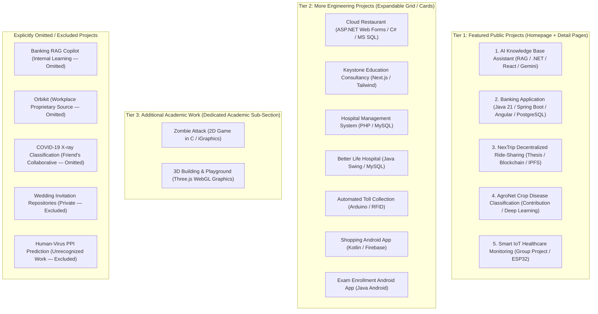
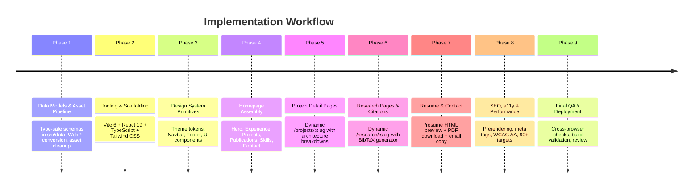

# Portfolio Modernization — Final Implementation Plan

**Project:** Mostafiz Fahim Engineering Portfolio  
**Repository:** `https://github.com/MostafizFahim/my-portfolio`  
**Working Directory:** `E:\My_portfolio`  
**Target Positioning:** Functional Engineer | Backend Engineer | Full Stack AI Engineer  
**Design Direction:** Premium Dark  
**Layout:** Hybrid — Single-page Homepage + Dedicated Detail Pages  
**Status:** **Approved & Ready for Phase 1 Scaffolding**  
**Date:** November 2026  

---

## 1. Executive Summary

Modernize the existing portfolio into a professional engineering portfolio that demonstrates verified commercial software engineering experience, backend development, banking systems, applied AI/ML projects, and published academic research.

The modernization replaces the legacy Create React App architecture with a maintainable **React 19, TypeScript, Vite 6, and Tailwind CSS** architecture.

The portfolio features:
1. A polished, recruiter-friendly single-page homepage.
2. Dedicated project detail pages for technically significant, public projects.
3. A research and publication section containing verified, peer-reviewed academic work.
4. An expandable section for additional engineering and academic projects.
5. A responsive HTML resume page and downloadable PDF.
6. **Strict and verified separation** between commercial experience, internship projects, personal systems, implementation contributions, and collaborative group projects.
7. **Complete confidentiality protection:** Workplace proprietary code (Orbikit) and internal learning experiments (Banking RAG Copilot) are completely omitted. Internship achievements (Asset Tagging System, Task Management System) are presented strictly via non-confidential high-level summaries without private repository links.

The design uses a **premium dark interface** with restrained cyan accents, readable typography, subtle motion, and authentic engineering visuals.

### Primary Objectives:
- Establish a credible professional identity as a **Functional Engineer / Backend Engineer** with banking domain experience and AI engineering capabilities.
- Showcase commercial enterprise software experience at **Sonali Intellect Limited** without exaggerating responsibilities.
- Demonstrate practical backend, full-stack, AI/ML, and research capabilities.
- Organize GitHub projects by technical relevance, ownership, and verified contribution.
- Improve maintainability, performance, accessibility, SEO, and deployment reliability.
- Preserve useful historical projects without giving every academic project equal prominence.

---

## 2. Confirmed Design Decisions

### 2.1 Visual Direction: Premium Dark
* **Background:** `#09090b` (Deep Zinc Black)
* **Surface:** `#121215`
* **Elevated Surface:** `#18181b`
* **Borders:** Subtle zinc/neutral borders (`rgba(255, 255, 255, 0.08)`)
* **Primary Accent:** Cyan `#06b6d4`
* **Secondary Accent:** Indigo `#6366f1`, used sparingly for secondary badges
* **Primary Typography:** `Inter` or `Geist Sans`
* **Monospace Typography:** `JetBrains Mono`

#### Visual Principles:
- Clear information hierarchy with generous, comfortable text contrast.
- Restrained gradients and subtle ambient lighting.
- Subtle card and navigation micro-interactions.
- **No excessive particle animations** (no canvas loops).
- **No generic cartoon avatars** or template clipart.
- Full respect for the `prefers-reduced-motion` media query.
- Prioritize authentic project screenshots, system architecture diagrams, and technical visuals.

### 2.2 Layout: Hybrid Architecture
* **Main Homepage (`/`):**
  1. Hero & Professional Value Proposition
  2. About & Core Capabilities
  3. Professional Experience & Internship (Sonali Intellect Limited)
  4. Featured Engineering Projects (Tier 1 Public Systems)
  5. Applied AI & Machine Learning Contributions (AgroNet)
  6. Research & Publications (4 Peer-Reviewed Published Papers)
  7. More Engineering Projects (Tier 2 Expandable / Filterable)
  8. Additional Academic Work (Tier 3: Zombie Attack, 3D Building)
  9. Technical Skills Matrix (Domain Grouped)
  10. Education & Academic Background (AUST)
  11. Contact & Professional Links
* **Dedicated Routes:**
  - `/projects/:slug` (Deep architectural breakdowns for public featured systems)
  - `/research/:slug` (Full abstracts, venue data, and BibTeX citations)
  - `/resume` (Responsive HTML resume + direct PDF download)
  - Custom `404` NotFound page

*The homepage remains concise for rapid recruiter scanning; in-depth technical documentation lives on dedicated detail pages.*

---

## 3. Technology Stack

| Technology | Purpose | Implementation Notes |
| :--- | :--- | :--- |
| **Vite** | Build tooling & dev server | Latest stable release; eliminates 97 CRA vulnerabilities, provides sub-50ms HMR. |
| **React** | Component UI library | React 19; modern component patterns, `createRoot`, asset preloading. |
| **TypeScript** | Type safety & contracts | Strict schemas for experience, projects, publications, and skills. |
| **Tailwind CSS** | Utility design system | Clean tokens, replaces 1,800+ lines of monolithic `!important` CSS. |
| **Framer Motion** | Restrained animation | Subdued section transitions and tabs; reduced-motion safe. |
| **React Router** | Client-side routing | Powers hybrid SPA routing (`/`, `/projects/:slug`, `/research/:slug`, `/resume`). |
| **Lucide React** | Consistent iconography | Tree-shakeable, clean 24px grid icons. |

### Explicitly Excluded (To Prevent Bloat):
- `react-tsparticles` (Causes CPU/GPU drain and battery consumption)
- `typewriter-effect` (Causes layout shift and reading delays)
- Heavy PDF rendering libraries (`react-pdf`, `@react-pdf/renderer`)
- Unnecessary HTTP client libraries (standard browser `fetch` suffices)
- Unnecessary UI bloat packages

---

## 4. Website Architecture

```
src/
├── assets/
│   └── images/
│       ├── projects/         # WebP screenshots & architecture diagrams
│       ├── research/         # Publication figures & venue marks
│       └── branding/         # SVG monograms & favicon assets
├── components/
│   ├── common/               # Navbar, Footer, SectionHeading, Button, Badge, Breadcrumb
│   ├── home/                 # Hero, About, Experience, ProjectsSection, ResearchSection, Skills, Education, Contact
│   ├── projects/             # ProjectCard, ProjectFilter, ArchitectureDiagram, MetricCard
│   ├── research/             # PublicationCard, BibTeXModal, AbstractDrawer
│   └── resume/               # ResponsiveResume, DownloadActions
├── data/
│   ├── experience.ts         # Verified commercial & internship engineering records
│   ├── projects.ts           # Tier 1, 2, and 3 project datasets
│   ├── publications.ts       # Verified peer-reviewed papers & BibTeX
│   ├── skills.ts             # Domain-grouped technical competencies
│   └── education.ts          # AUST B.Sc. degree & academic background
├── layouts/
│   └── RootLayout.tsx        # Navbar + ScrollToTop + Main + Footer
├── pages/
│   ├── HomePage.tsx          # Single-page consolidated portfolio
│   ├── ProjectDetailPage.tsx # Dynamic deep dive (/projects/:slug)
│   ├── ResearchDetailPage.tsx# Academic details & BibTeX (/research/:slug)
│   ├── ResumePage.tsx        # Responsive HTML CV + download (/resume)
│   └── NotFoundPage.tsx      # Clean 404 handler
├── styles/
│   └── index.css             # Tailwind directives & CSS variables
├── types/
│   ├── project.types.ts
│   ├── experience.types.ts
│   ├── publication.types.ts
│   └── skill.types.ts
├── App.tsx                   # Route definitions
└── main.tsx                  # React 19 entry point
public/
├── images/
├── Mostafiz_Fahim_CV.pdf     # Preserved exact filename & path
├── robots.txt
└── sitemap.xml
```

---

## 5. Professional Identity & Verified Employment Strategy

### 5.1 Professional Positioning
* **Headline:** *"Functional Engineer building reliable backend systems and practical AI applications."*
* **Supporting Narrative:** *"Functional Engineer at Sonali Intellect Limited specializing in enterprise banking systems and Java-related backend engineering, with active project work across full-stack applications and applied deep learning research."*
* **Strict Realism:** Commercial banking domain experience is clearly presented without exaggerating responsibilities or inventing unverified metrics.

### 5.2 Professional Experience (100% Verified)
* **Employer:** **Sonali Intellect Limited (SIL)**
  - *Company Context:* Leading enterprise banking software company providing core banking solutions for **Sonali Bank** and **Rupali Bank**.
* **Positions & Timeline:**
  - **Functional Engineer (Permanent):** 1 August 2026 – Present
  - **Functional Engineer Intern:** 1 February 2026 – 31 July 2026
* **Verified Technical Scope (Java-Related):**
  - Developing and maintaining backend services using **Java 17/21, Spring Boot, Spring MVC**, and relational databases.
  - Contributing to core banking applications, transaction processing workflows, and secure API integrations.
  - Working with **MySQL** and **MS SQL Server** for data modeling, query optimization, and transaction handling.
  - Frontend integrations with **Angular, TypeScript**, and JWT authentication.
  - Enterprise software maintenance, bug fixing, and functional validation.
* **Internship Deliverables:**
  - **Task Management System:** Built a JSP/Servlet MVC web application with user authentication, input validation, and relational database persistence.
  - **Asset Tagging System:** Developed enterprise asset identification and tracking workflows.

---

## 6. Project Categorization & Prioritization



### 6.1 Tier 1 — Featured Public Projects (Homepage + Dedicated Detail Pages)

1. **AI Knowledge Base Assistant**
   - *Category:* AI Applications / Full Stack
   - *Repository:* `https://github.com/MostafizFahim/ai-knowledge-base-assistant`
   - *Stack:* ASP.NET Core Web API, EF Core, SQLite, React, TypeScript, Tailwind CSS, Gemini API (`gemini-2.5-flash`), JWT authentication.
   - *Verified Implementation:* Document ingestion (PDF/CSV), automatic semantic chunking, keyword-based top-5 chunk retrieval, prompt context construction, user chat history, Dockerfile, Railway backend, and Vercel frontend.
2. **Banking Application**
   - *Category:* Backend / Enterprise Systems
   - *Repository:* `https://github.com/MostafizFahim/banking-microservices`
   - *Stack:* Java 21, Spring Boot 3.2.4, Spring Security, Angular 21, TypeScript, Supabase PostgreSQL, H2, JWT.
   - *Verified Implementation:* Layered backend (controllers, DTOs, entities, repositories), role-based security (`CUSTOMER` vs `ADMIN`), account transactions (deposit, withdrawal), transaction summaries, CSV export, Chart.js analytics, Dockerfile, Railway + Vercel deployment.
   - *Naming Correction:* Labeled as **"Banking Application"** to accurately reflect implementation without unverified microservices architecture claims.
3. **NexTrip — Decentralized Ride-Sharing Platform (Undergraduate Thesis)**
   - *Category:* Blockchain / Full Stack / Undergraduate Thesis
   - *Repositories:* `Ride-Sharing-Dapp-Web-Thesis-project`, `NexTrip-Ride-Sharing-Dapp-Mobile`, `NexTrip-ride-sharing-web-app-version2`.
   - *Presentation:* Represented as one cohesive project spanning smart contracts, mobile, and web implementations.
   - *Stack:* Permissioned Ethereum Geth, Solidity, IPFS, React, Node.js, MetaMask, Material UI.
   - *Authors:* Mostafizur Rahman Fahim, Sk. Md. Shadman Ifaz, Rayhan Ferdous Srejon; Supervisor: Mr. Md. Khairul Hasan (AUST).
4. **AgroNet — Cucumber Leaf Disease Classification**
   - *Category:* Applied AI / Machine Learning
   - *Repository:* `https://github.com/MostafizFahim/AgroNet-Cucumber-Leaf-Disease-Classification`
   - *Ownership Statement:* **Implementation contribution to sister's project.**
   - *Publication Status:* **Explicitly confirmed: No publication associated with AgroNet.**
   - *Verified Implementation:* Deep learning notebook comparing Custom CNN baseline (94.12% accuracy, 94.19% F1), VGG16 transfer learning (92.16% accuracy), Vision Transformer (90.20% accuracy), and Hybrid CNN-VGG16-ViT feature fusion (94.12% accuracy, 94.19% F1) on a Kaggle dataset across 3 classes (`Healthy_leaves`, `Downy_mildew`, `Powdery_mildew`).
5. **Smart IoT Healthcare Monitoring**
   - *Category:* IoT / Embedded Systems / Healthcare
   - *Repository:* `https://github.com/MostafizFahim/Smart-IoT-Healthcare-Real-Time-Vital-Sign-Tracking-and-ECG-Arrhythmia-Detection-Using-ESP32`
   - *Classification:* **Collaborative Group Project** (almost all implementation executed by user).
   - *Hardware & Stack:* ESP32 Dev Kit, MAX30102 (Heart Rate & SpO2), AD8232 (ECG), DS18B20 (Temperature), DHT11, SSD1306 OLED, Firebase Realtime Database, ThingSpeak, mobile-responsive ESP32 web interface.
   - *Authors:* Mostafizur Rahman Fahim, Asadut Jaman, Naeema Jannat, Sayeda Fatema Nimu, Amrita Dewanjee.
   - *Important Disclaimer:* Explicitly documented as an academic IoT prototype, not a clinical medical diagnostic device.

### 6.2 Tier 2 — More Engineering Projects (Expandable / Filterable Grid)
- **Cloud Restaurant Management System:** ASP.NET Web Forms, C#, Microsoft SQL Server, .NET Framework 4.8, iTextSharp. Academic group project (CSE 3224 Lab at AUST; co-developers: Naeema Jannat, Mostafiz Fahim, Asadut Jaman).
- **Keystone Education Consultancy:** Next.js, React, Tailwind CSS, Vercel deployment.
- **Hospital Management System (PHP):** Plain PHP 8+, MySQL, Bootstrap 5, jQuery. Multi-portal system (Super Admin, Admin, Doctor, Patient).
- **Better Life Hospital (Java):** Java Swing desktop application, MySQL, JDBC.
- **Automated Toll Collection System:** Arduino Uno/Nano, MFRC522 RFID, Servo motor, IR sensors, 16x2 I2C LCD, 4x4 Keypad.
- **Shopping Android App:** Kotlin, Android Studio, Firebase.
- **Exam Enrollment Android App:** Java, Android SDK.

### 6.3 Tier 3 — Additional Academic Work (Dedicated Academic Sub-Section)
- **Zombie Attack — 2D Game:** C/C++, iGraphics framework, OpenGL/GLUT. 2D arcade survival game with bitmap animations, collision detection, and score tracking.
- **3D Building & Playground:** Three.js WebGL graphics scene.

### 6.4 Explicitly Omitted / Excluded Projects
- **Banking RAG Copilot:** Omitted (learning internally).
- **Orbikit:** Omitted (workplace proprietary source).
- **COVID-19 X-ray Classification:** Omitted per user instruction.
- **Private Wedding Invitation Repositories:** Excluded completely.
- **Human-Virus Protein-Protein Interaction (PPI) Prediction:** Excluded completely.

---

## 7. Research and Publications (All 4 Confirmed Published)

A dedicated section featuring verified, peer-reviewed academic publications. Mostafizur Rahman Fahim is verified as **2nd Author** on all four:

1. **"Predicting Agricultural Land Suitability and Soil Quality: A Deep Learning Approach for Precision Agriculture"**
   - **Venue:** Springer Conference
   - **Authorship:** 2nd Author | **Status:** Published
   - **Official Link:** `https://link.springer.com/chapter/10.1007/978-3-032-15764-5_39`
2. **"NexTrip: A Semi-Public Blockchain Architecture for Privacy-Preserving Ride-Sharing with RAFT Consensus and IPFS-Enabled Data Storage"**
   - **Venue:** IEEE ICCIT 2025
   - **Authorship:** 2nd Author | **Status:** Published
   - **Official Link:** `https://ieeexplore.ieee.org/document/11491718`
3. **"Machine Learning for Monkeypox Prediction"**
   - **Venue:** IEEE QPAIN 2025
   - **Authorship:** 2nd Author | **Status:** Published
   - **Official Link:** `https://ieeexplore.ieee.org/document/11171682`
4. **"Design of Blockchain Ride-Sharing with IPFS"**
   - **Venue:** International Journal of Advanced Information Technology (IJAIT)
   - **Authorship:** 2nd Author | **Status:** Published
   - **Official Link:** `https://www.researchgate.net/publication/395545438`

### Research Page & Modal Features:
- Full title, exact author order, venue, and publication year.
- Direct links to IEEE Xplore, SpringerLink, and ResearchGate.
- One-click formatted **BibTeX citation generator**.
- *Strict Rule:* AgroNet must **never** be presented as a publication.

---

## 8. Contact & Resume Architecture

### 8.1 Contact Information
* **Public Contact Email:** `mostafizfahim@gmail.com`
  - Wired to all public mailto links, contact cards, and resume header.
* **Office Email:** `mostafizur.fahim@sonaliintellect.com`
  - **Private / internal only. Will not be displayed publicly.**
* **Professional Profiles:**
  - GitHub: `https://github.com/MostafizFahim`
  - LinkedIn: `https://www.linkedin.com/in/mostafiz-fahim-a430b1230`
  - ResearchGate: `https://www.researchgate.net/profile/Mostafiz-Fahim/research`

### 8.2 Resume System
* **File Location & Preservation:** `public/Mostafiz_Fahim_CV.pdf`
  - **Preserve exact path and filename.** The existing file remains active until the user supplies their updated PDF.
* **Dedicated Route (`/resume`):**
  - ATS-friendly responsive HTML resume matching the PDF data.
  - Sticky download actions: `[Download PDF CV]` and `[Print Resume]`.

---

## 9. Design System & Component Library

### Reusable UI Primitives (`src/components/common/`):
- `Navbar.tsx`: Frosted glass blur, responsive mobile drawer, accessible keyboard navigation, no scroll memory leaks.
- `Footer.tsx`: Minimal, with verified professional links and source notice.
- `SectionHeading.tsx`: Consistent hierarchy with eyebrow label and subheading.
- `Badge.tsx`: Distinct variants for tech tags, live status, and venue types.
- `Button.tsx`: High-contrast primary (cyan) and secondary (zinc) buttons with accessible focus rings (`focus-visible:ring-2`).
- `ProjectCard.tsx`: Thumbnail, tags, role/contribution badges, repo/live links, and detail link.
- `PublicationCard.tsx`: Venue badge, author string, links, and BibTeX trigger.
- `ExperienceTimeline.tsx`: Clean corporate timeline for Sonali Intellect Limited.
- `MetricCard.tsx`: Displaying verified benchmarks without unverified claims.

---

## 10. Migration Strategy & Vercel Deployment

### 10.1 Step-by-Step Transition Plan
1. **Preserve Clean Rollback Point:** Create a dedicated Git migration branch (`modernization/vite-react19`).
2. **Asset Reference Check & Safety:**
   - Scan every asset before removal.
   - Retain all referenced project screenshots and convert to WebP.
   - Remove confirmed foreign template files (`Soumyajit_Behera-BIT_MESRA.pdf` and unused PNGs).
3. **Scaffold Modern Build:**
   - Initialize Vite 6, React 19, TypeScript, and Tailwind CSS.
   - Configure `tsconfig.json` and `vite.config.ts`.
4. **Data Modeling:** Implement type-safe models in `src/data/`.
5. **Component Assembly:** Build layout, homepage sections, detail pages, and resume route.
6. **Vercel Routing:** Configure `vercel.json` for SPA rewrites to ensure direct route refreshes resolve cleanly.

### 10.2 Vercel Configuration (`vercel.json`)
```json
{
  "rewrites": [
    {
      "source": "/(.*)",
      "destination": "/index.html"
    }
  ]
}
```

---

## 11. Implementation Phases & Deliverables



---

## 12. Final Implementation Rules

1. **Do not invent** professional experience, project ownership, metrics, or research outcomes.
2. **Present exact verified designation:** Functional Engineer (Permanent, Aug 2026–Present) and Functional Engineer Intern (Feb 2026–Jul 2026) at Sonali Intellect Limited.
3. **Distinguish strictly** between commercial employment, personal projects, implementation contributions, and group projects.
4. **Protect confidentiality completely:** Never publish proprietary code, internal architecture diagrams, or private repository links.
5. **Do not present** AgroNet as a published paper.
6. **Exclude** private wedding invitation repositories, Human-Virus PPI, Banking RAG Copilot, Orbikit, and COVID-19 X-ray completely.
7. **Preserve** the existing CV path (`public/Mostafiz_Fahim_CV.pdf`).
8. **Keep** Zombie Attack and Three.js Building under additional academic engineering work.
9. **Do not deviate** from the agreed dark visual direction without approval.
10. **Do not add** unnecessary backend infrastructure.
11. **Work phase by phase** and request explicit review before advancing to the next major phase.
12. **Do not commit, push, or deploy** without permission.

---

**Status:** Implementation plan updated and finalized with 100% verified data.  
**Ready to begin Phase 1 on dedicated Git migration branch.**
